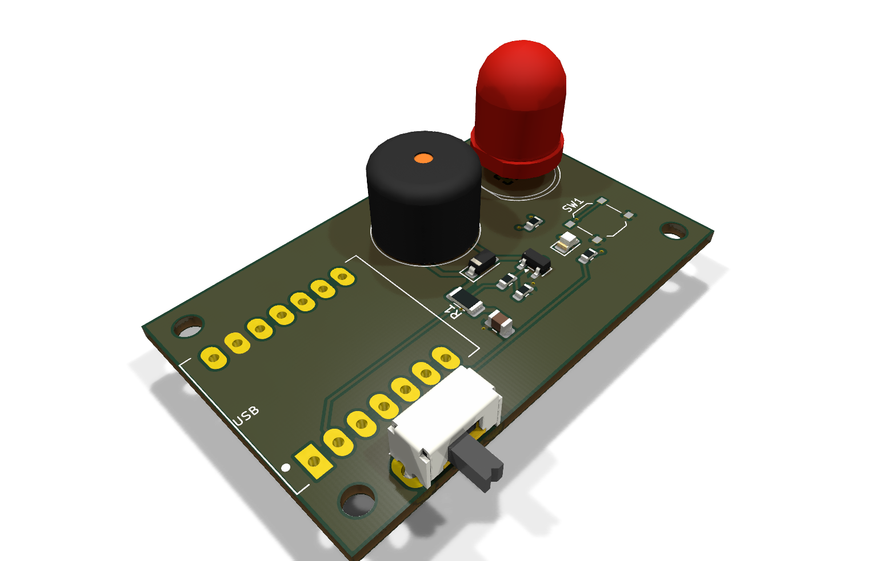

# Rev 1 carrier board: schematic and BOM (for review)

A small 2-layer board (52 × 32 mm) that carries a **Seeed XIAO ESP32C3** and adds the alarm, two LEDs, a button and the arm/quiet switch. JLCPCB assembles all the surface-mount parts. You hand-solder the XIAO (14 joints), the buzzer (2), the 10 mm LED (2) and the slide switch (5).

Status: **draft board** in [`kicad/`](kicad/): placed, autorouted and DRC-clean, but not yet checked against real parts. See [Board draft](#board-draft) and [Before ordering](#before-ordering).

## Power
Power comes from USB-C on the XIAO, from a phone charger. The board takes `5V` (VBUS) and `3V3` from the XIAO's pins and needs no regulator of its own. The XIAO's battery pads are left unused for now.

## Schematic

```
                         XIAO ESP32C3 (U1)
                     ┌────────────────────────┐
                     │ D0  GPIO2   (strap) nc │
       ALARM_GATE ◄──┤ D1  GPIO3              │
       BUTTON     ───┤ D2  GPIO4              │
       SWITCH     ───┤ D3  GPIO5              │
                     │ D4  GPIO6  SDA      nc │  ← kept free for a future I²C screen
                     │ D5  GPIO7  SCL      nc │
       LED_GREEN  ◄──┤ D6  GPIO21             │
                     │ D7  GPIO20          nc │
                     │ D8  GPIO8   (strap) nc │
                     │ D9  GPIO9   (strap) nc │  ← on-board BOOT button, also works as the button
       LED_RED    ◄──┤ D10 GPIO10             │
             +5V  ◄──┤ 5V                     │
                     │ 3V3                 nc │
             GND  ───┤ GND                    │
                     └────────────────────────┘

Alarm (low-side switch). A MOSFET rather than driving from the GPIO: the transducer
wants ~5 Vp-p and up to ~100 mA, more than a pin should supply.

     +5V ──┬──────────── R1 ──────┬────────┐
           │         10 Ω 1206    │        │
          C1 10µF                BZ1+      D1 1N4148W
           │                      │ BZ1    │ (cathode to BZ1+)
          GND                    BZ1-      │
                                  ├────────┘
                                  │ D
       ALARM_GATE ── R2 ──┬──── G Q1 AO3400A
                    100 Ω │       │ S
                         R3 100k  │
                          │       │
                         GND     GND

     R3 holds the gate low while the ESP32 is in reset or booting, so the alarm
     can't sound during power-up or a firmware update.
     R1 sets the volume. Tune it on the chosen part; use 0 Ω for 5 V-rated parts.

LEDs (driven straight from the GPIO pins)

     LED_GREEN ── R4 100 Ω ──►|── GND     LED2 green 0805, status (~5 mA)
     LED_RED   ── R5 100 Ω ──►|── GND     LED1 red 10 mm diffused, alert (~13 mA)

Inputs (internal pull-ups enabled in firmware)

     BUTTON ── SW1 ── GND                 tactile; the 3D-printed case has the large cap
     SWITCH ── SW2 common
               SW2 pos A ── GND           = quiet
               SW2 pos B ── nc            = armed (pulled up)
```

### Alarm part (BZ1)
The board draft uses a **standard 12 mm passive magnetic buzzer**: the common 12 × 9.5 mm (or 12 × 8.5 mm) through-hole part with 7.6 mm pin spacing, rated 5 V, with a coil of about 16 Ω and resonance around 2.3–2.7 kHz. The long lead (or the `+` mark) goes to the square pad. Run the firmware with `Alarm drive → Square wave`, and set `CONFIG_NOTIFIER_ALARM_FREQ_HZ` to the part's resonant frequency; generic ones vary, so sweep it by ear on the sample.

R1 sets the volume. Start with 10 Ω and measure the current: these coils are rated around 30–40 mA, so lower R1 (down to 0 Ω) for a louder alarm or raise it to soften it.

The same circuit also takes the other candidates that fit the footprint, with only R1 and the firmware mode changing:

| Candidate | R1 | Firmware `Alarm drive` |
|---|---|---|
| Generic 12 mm passive magnetic, 5 V, 16 Ω (draft default) | 10 Ω (tune) | Square wave at its resonance |
| PUI **AT-1224-TWT-5V-2-R**, magnetic, 2.4 kHz, 5 V | 0 Ω | Square wave, 2400 Hz |
| 12 mm 5 V active buzzer, e.g. PUI **AI-1223-TWT-5V-R** or Cylewet CYT1036 | 0 Ω | On/off; D1 not needed but harmless |

The SMD Huaneng **MLT-8530** (LCSC C94599) would let JLCPCB place the buzzer too, but it needs a different footprint.

## BOM
"Basic" means a JLCPCB basic part (no per-order feeder fee). Where the listing didn't say, the status is marked unconfirmed; JLCPCB's BOM upload will show it.

| Ref | Qty | Part | Package | LCSC / source | JLCPCB | Notes |
|---|---|---|---|---|---|---|
| U1 | 1 | Seeed XIAO ESP32C3 | Module, castellated | Amazon (you have them) | Hand-solder | Footprint has castellated pads **and** 2.54 mm holes, so pin headers also fit |
| Q1 | 1 | AO3400A N-MOSFET, 30 V 5.7 A, Vgs(th) 1.45 V | SOT-23 | C20917 | Basic | Fully on at 3.3 V gate drive |
| D1 | 1 | 1N4148W | SOD-123 | C81598 | Unconfirmed (common basic part) | Flyback for the coil |
| BZ1 | 1 | 12 mm passive magnetic buzzer, 5 V, ~16 Ω (see above) | THT, 7.6 mm pitch | Amazon/LCSC | Hand-solder | 2 joints |
| R1 | 1 | 10 Ω 1%, 250 mW | 1206 | C17903 | Unconfirmed | Volume; 0 Ω for 5 V parts |
| R2 | 1 | 100 Ω 1% | 0603 | C22775 | Unconfirmed | Gate series resistor |
| R3 | 1 | 100 kΩ 1% | 0603 | C25803 | Unconfirmed | Gate pull-down |
| R4, R5 | 2 | 100 Ω 1% | 0603 | C22775 | Unconfirmed | LED current |
| C1 | 1 | 10 µF 25 V X5R | 0805 | C15850 | Unconfirmed | Local reservoir for alarm pulses |
| LED2 | 1 | Green LED, KT-0805G, 430 mcd @ 5 mA | 0805 | C2297 | Unconfirmed | Status; bright, so PWM dimming may be worth adding |
| LED1 | 1 | Red LED, 10 mm, diffused, wide angle (~300 mcd, 50–60°) | Through-hole, 2.54 mm | Digi-Key/Amazon | Hand-solder | Stands up through the lid, visible across a room |
| SW1 | 1 | Tactile switch, TS-1187A-B-A-B, 5.1×5.1 mm | SMD | C318884 | Basic | The case's printed button presses it |
| SW2 | 1 | Slide switch SPDT, right angle, C&K OS102011MA1QN1 | THT | C226259 (LCSC; Digi-Key backordered) | Hand-solder | 5 joints. Its 2 × 4 mm lever sticks out through the case wall |
| H1–H2 | 2 | M2.5 mounting holes | | | | For 3D-printed case standoffs |

Most of the assembled parts' basic/extended status is unconfirmed; JLCPCB's BOM upload shows any extended-part fees.

## Board draft


The KiCad 10 project is in [`kicad/`](kicad/): open `sar-pager.kicad_pro`. More renders are in [`kicad/renders/`](kicad/renders/). The 3D view has no models for the XIAO or SW1, so they show as bare pads.

**Layout (52 × 32 mm, 2 layers, 1.6 mm):**
- **XIAO (U1):** on the left, with its USB-C end flush with the board edge so the cable comes in through the case wall. No vias under it, because its underside has exposed battery and test pads.
- **Top edge:** the buzzer (BZ1) and the 10 mm red LED (LED1), the two things that need lid openings.
- **Alarm driver:** Q1, D1, R1 (volume), R2, R3 and C1 sit together between the buzzer and the XIAO.
- **Right:** the button (SW1), with the green LED (LED2) next to it.
- **Bottom edge, under the XIAO:** the arm/quiet slide switch (SW2), with its body flush with the board edge. Its 2 mm wide lever sticks out 4 mm past the board, about 1.5 mm past a 2 mm case wall, so it can be flipped with a fingertip. The wall slot needs about 4.5 × 2.5 mm for the lever and its 2 mm of travel.
- **Mounting:** three M2.5 holes (H1–H3) for case standoffs.
- **Ground:** filled on both layers. 5 V and the buzzer loop use 0.5 mm tracks, signals 0.25 mm. The rules suit JLCPCB's standard process (0.2 mm clearance, 0.3/0.6 mm vias).

**Antenna:** the XIAO ESP32C3 uses the **external FPC antenna** on its u.FL connector. The case needs a spot to stick it to an inside wall, away from the buzzer's magnet and coil.

**Case:** LED1 is mounted tall (leads left long, or on a printed spacer) so it sits flush with or proud of the lid. LED2 shows through a short piece of 1/16" clear acrylic rod glued into the lid. The 3D-printed lid needs holes for LED1, LED2, the button cap over SW1 and the sound port over BZ1, plus wall cut-outs for USB-C and SW2's lever. The case is in [`case/`](case/README.md).

### How it was made, and how to change it
`generate.py` places the parts and assigns the nets, Freerouting routes the board, and `finish.py` adds the ground fill. `./build.sh` runs all of that, then DRC, renders and fab files. It needs KiCad 10 and Docker.

That route is only for the first draft. **Now that the board exists, edit `sar-pager.kicad_pcb` in KiCad**, then run `./build.sh fab` to re-check it and re-export. A full `./build.sh` would regenerate the board and overwrite any hand edits. There's no schematic yet: the nets come from the table in `generate.py`, which follows the schematic above.

**Outputs of `./build.sh fab`** (in `kicad/fab/`, not committed):
- `sar-pager-gerbers.zip`: Gerbers and drill files for JLCPCB
- `bom-jlcpcb.csv` and `cpl-jlcpcb.csv`: the assembly BOM (LCSC part numbers) and placement file. The hand-soldered parts are left out.
- `drc.rpt`: the DRC report

## Before ordering
This is a draft. Check these before sending it to a fab:
- [ ] **XIAO footprint.** It's drawn from Seeed's published dimensions: 21 × 17.8 mm, pin rows 15.24 mm apart, pins centred along the length. Compare it with Seeed's official KiCad footprint, or print the board 1:1 and lay a XIAO on it.
- [ ] **Buzzer.** Check the sample's pin spacing (7.6 mm) and polarity, and its height (9.5 mm) against the case.
- [ ] **Slide switch.** Confirm which lever position connects pin 2 to pin 1 (GND = quiet), and label the case to match. Check that the lever sticks out far enough once the case is printed; thinning the wall around the slot gains about 1 mm.
- [ ] **JLCPCB rotations.** Check the parts in JLCPCB's placement preview after uploading the CPL file. SOT-23 and polarized parts (D1, LED2, Q1) sometimes need a rotation correction.
- [ ] **LED2 brightness.** 430 mcd at about 5 mA may be glaring at night. Raise R4 if so.
- [ ] **A schematic.** For anything beyond this draft, capture the schematic in KiCad so ERC and "Update PCB from schematic" work.

## Firmware
The defaults in `firmware/main/Kconfig.projbuild` match this pin map: alarm GPIO3, button GPIO4 plus BOOT (GPIO9), switch GPIO5, green LED GPIO21, red LED GPIO10. The default is square-wave drive at 2700 Hz. Logs go over the XIAO's USB-C (USB-Serial-JTAG), which leaves GPIO20/21 free.
