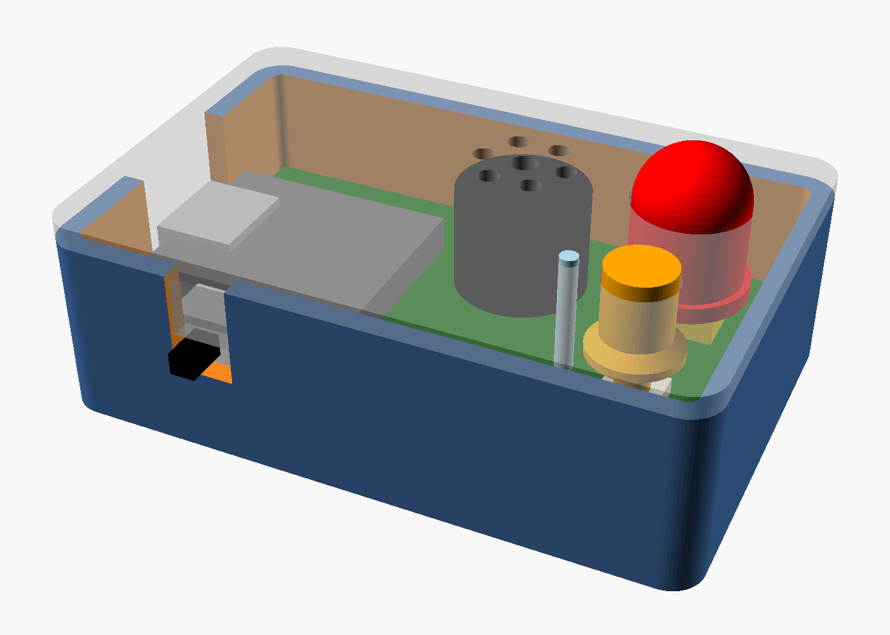
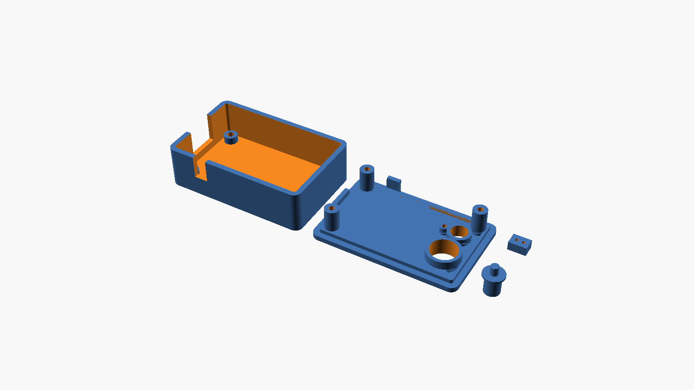

# Rev 1 case (OpenSCAD)

A 3D-printed case for the [rev 1 board](../README.md): **57 × 37 × 18.6 mm**. The red LED's dome rises 5 mm above the lid so it's visible across a room (`led1_dome`).

Everything is in [`sar-pager-case.scad`](sar-pager-case.scad). The part positions are copied from the KiCad board, and the dimensions and fits are parameters at the top of the file.

## Parts
Run `./build.sh` (needs Docker) to export STLs to `out/` and refresh `renders/`. Or open the `.scad` in OpenSCAD, set `part`, render (F6) and export.

| Part | Prints | Notes |
|---|---|---|
| `base` | Open side up | Floor, walls, three standoffs. The USB-C and slide-switch openings are notched from the top so the board drops in |
| `lid` | Top face down | Plate with a locating lip, three screw posts that also clamp the board, and tabs that close the tops of the wall openings |
| `button` | Cap down | Rests on SW1 and sticks up 1.2 mm through the lid. A flange under the lid's guide sleeve keeps it from falling out |
| `led_spacer` | Any way | Holds the red LED at the right height while you solder it |

None of the parts need supports. PLA or PETG, 0.2 mm layers and 3 walls all work.

**Bought parts:**
- **Screws:** 3 × M2.5 × 12 mm pan-head. They go up through the floor and the board's mounting holes, and cut their own threads in the lid's posts (2.2 mm pilot holes). One set of screws holds the base, board and lid together.
- **Light pipe:** a 10.7 mm piece of **1/16" (1.6 mm) clear acrylic rod** from a hardware or craft store, for the green status LED. Sand the bottom end flat and smooth; a frosted top (about 400 grit) glows more evenly. It stands 0.5 mm above the lid, 1 mm above the LED (`lightpipe_proud`, `lightpipe_gap`; the length is echoed when rendering).

## Assembly
1. **Red LED (LED1):** put `led_spacer` (3.5 mm) on the board under the LED's leads, push the LED down onto it, and solder. Then only its dome shows above the lid, and a collar under the lid locates it and keeps its light out of the case.
2. **Into the lid:** push the rod into its hole from the top and glue it from inside with a drop of clear epoxy or UV resin. Superglue can fog acrylic. Then drop the button (plunger down) in from the inside.
3. **Into the base:** lower the board into the base. The slide switch lever and the USB-C end go into their wall notches.
4. **Close it:** put the lid on, turn the case over, and fit the three screws.
5. **Antenna:** stick the XIAO's FPC antenna to the inside of the lid or a wall, away from the buzzer.

## Openings
- **Lid:**
  - the 10.4 mm red LED hole, with a collar down to the LED's flange
  - 7 sound holes over the buzzer
  - the button (6.4 mm, with a guide sleeve)
  - the light pipe rod (1.8 mm, with a 3 mm guide tube underneath to hold it straight and keep its light in)
- **Left wall:** a 13 × 8 mm USB-C opening, big enough for most cable overmolds.
- **Bottom wall:** the slide switch slot, about 5.5 × 3 mm, covering both lever positions. The lever sticks out about 1.5 mm. Set `wall` thinner, or add a local recess, for more.

## Check these on the first print
These dimensions come from KiCad's 3D models or common part sizes, not from the actual parts:
- **USB-C height (`usb_z`):** set for a XIAO soldered flat by its castellations. On pin headers the XIAO sits about 2.5 mm higher; raise `usb_z` to match.
- **Slide switch lever (`sw2_lever_z`):** 1.6–3.6 mm above the board, from the C&K 3D model.
- **Red LED:** sized for a standard 10 mm LED, 13.5 mm from the bottom of its flange to the top of the dome (`led1_h`), with a 1.5 mm flange (`led1_flange_h`). Measure yours: the spacer height comes from these.
- **Button travel:** the plunger stops 0.2 mm above SW1. If the button feels mushy or doesn't click, adjust the `+ 0.2` in `button()`.
- **Fit (`fit` = 0.2 mm):** loosen it if the lid, button or tabs bind on your printer.
- **Light pipe hole (`lightpipe_hole` = 1.8 mm):** a slip fit for 1/16" rod, allowing for printed holes coming out small. If it's tight, open it with a 1.6–1.8 mm drill. For a 1/8" rod, set `lightpipe_d` and `lightpipe_hole` to 3.175 and 3.3.
